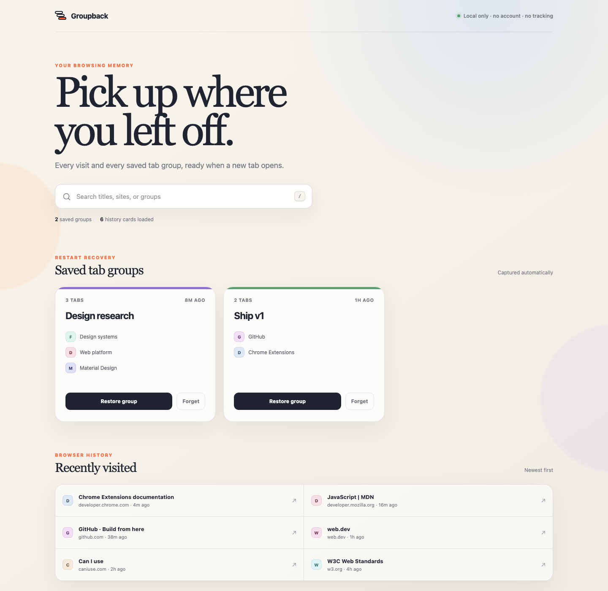

# Groupback — Restore Tab Groups from Every New Tab

[](https://developer.chrome.com/docs/extensions/develop/migrate/what-is-mv3)
[](PRIVACY.md)
[](https://github.com/Amossse/groupback/actions/workflows/ci.yml)
[](LICENSE)

**Groupback turns Chrome's New Tab page into a fast visual history and tab-group recovery dashboard.** It automatically remembers open tab groups and imports multi-tab windows from Chrome's recently closed sessions, then restores them with one click.

No account. No cloud. No analytics. No build step.



## Why Groupback?

Browser history remembers pages, but not the way you organized them for a task. Session managers often add a separate workflow: open a popup, name a session, and remember to save it.

Groupback makes recovery the default surface:

- **New Tab is the dashboard** — no popup to hunt for.
- **Tab groups are captured automatically** — no manual save button.
- **One click restores the full group** — title, color, order, and URLs included.
- **Browser history is searchable and card-based** — load older records until you reach what you need.
- **Everything stays local** — zero network requests and zero host permissions.

## Install in 60 seconds

```bash
git clone https://github.com/Amossse/groupback.git
```

1. Open `chrome://extensions` in Chrome, Edge, Brave, Arc, or another Chromium browser.
2. Enable **Developer mode**.
3. Click **Load unpacked**.
4. Select the cloned `groupback` folder.
5. Open a new tab.

There is no dependency install or build command.

## How it works

Groupback uses standard Manifest V3 browser APIs:

- `chrome_url_overrides` replaces the New Tab page.
- `chrome.history` provides searchable page history.
- `chrome.sessions` captures recently closed multi-tab windows and restores them natively while available.
- `chrome.tabs` and `chrome.tabGroups` capture and recreate groups.
- `chrome.storage.local` keeps up to 200 recent group snapshots on your device.

Only `http://` and `https://` pages are stored or restored. Incognito tabs and browser-internal pages are excluded.

## Permissions

| Permission | Why it is needed |
| --- | --- |
| `history` | Read and search the history cards shown on New Tab. |
| `sessions` | Find and restore recently closed multi-tab windows shown in Chrome's history menu. |
| `tabs` | Read titles and URLs inside a tab group and reopen them. |
| `tabGroups` | Read group names/colors and recreate groups. |
| `storage` | Save group snapshots locally across restarts. |

Groupback requests no host permissions, injects no content scripts, loads no remote code, and sends no network requests. See [PRIVACY.md](PRIVACY.md).

## Known limits

- Open tab groups must be observed after installation; recently closed multi-tab windows already present in Chrome's session history are also captured.
- Restored pages start with fresh navigation state; unsaved form data and per-tab back/forward history are not available through the extension API.
- Chrome does not allow New Tab overrides in Incognito, so Groupback deliberately ignores Incognito data.
- The 200 most recent group snapshots are retained to stay within local extension storage limits.

## Development

```bash
npm test
npm run check
```

The extension is plain HTML, CSS, and JavaScript. Tests use Node's built-in test runner.

## Contributing

Small, focused fixes are welcome. Read [CONTRIBUTING.md](CONTRIBUTING.md) before opening a pull request.

## License

[MIT](LICENSE) © 2026 Amossse

If Groupback saves your workflow after a restart, star the repository and share the problem it solved for you. Real recovery stories help shape the next release.
